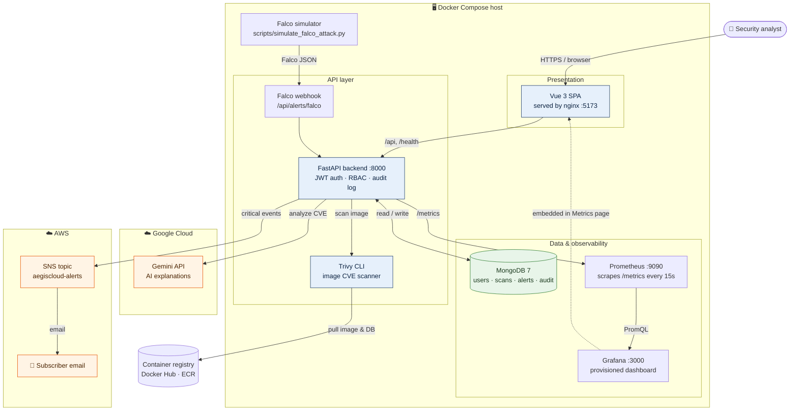

<div align="center">

# 🛡️ AegisCloud

### Container Vulnerability & Runtime Threat Defense Platform

[](https://python.org)
[](https://fastapi.tiangolo.com)
[](https://vuejs.org)
[](https://mongodb.com)
[](https://docker.com)
[](https://prometheus.io)
[](https://grafana.com)
[](LICENSE)

<br/>

**Scan container images. Watch runtime alerts. Understand every CVE in plain English.**

[Features](#-features) · [Architecture](#-architecture) · [Quick Start](#-quick-start) · [Configuration](#%EF%B8%8F-configuration) · [Testing](#-testing) · [Limitations](#%EF%B8%8F-limitations) · [License](#-license)

</div>

---

## 🎯 Problem

Containers ship with hidden risk. Base images carry hundreds of known CVEs, and most teams only learn about them after deployment. Traditional tools either scan once before release or monitor infrastructure, but rarely do both. Findings also arrive as raw CVE identifiers that are hard to act on.

**AegisCloud** combines static image scanning, runtime alerting, notifications and AI explanations in one platform, with a dashboard and metrics that show the overall posture.

---

## ✨ Features

| | Feature | What it does |
|:-:|---|---|
| 🔍 | **Image scanning** | Runs Trivy on any Docker image and stores every CVE, grouped by severity |
| ⚡ | **Runtime alerts** | Receives Falco-format detections on a webhook, with priority mapping and acknowledgement |
| 🤖 | **AI analysis** | Google Gemini explains a CVE in three parts: what it is, the attack scenario, and fix steps |
| 📧 | **Notifications** | AWS SNS emails subscribers when a critical scan or alert arrives |
| 📊 | **Live dashboard** | Risk score, severity breakdown, recent scans, open alerts and audit activity |
| 📈 | **Monitoring** | Prometheus scrapes `/metrics`; Grafana shows a provisioned dashboard, embedded in the app |
| 🔐 | **Access control** | JWT login, admin / analyst / viewer roles, and an audit log of every action |
| 📄 | **Reports** | Downloadable CSV and PDF scan reports |

---

## 🏗️ Architecture



### Request flow

1. **Scan:** the analyst submits an image. The API runs Trivy, stores the result in MongoDB, and returns the severity counts. A critical result also queues an SNS notification in the background.
2. **Alert:** a Falco event posts to the webhook. The API maps its priority, stores it, and queues an SNS email for critical events.
3. **Explain:** the analyst asks for an explanation. The API sends the CVE to Gemini and returns the three-part answer.
4. **Monitor:** Prometheus scrapes request, scan and alert counters from `/metrics`. Grafana reads them through its Prometheus datasource.

### Clouds used

| Cloud | Service | Role |
|---|---|---|
| **AWS** | SNS | Emails subscribers on critical scans and alerts |
| **Google Cloud** | Gemini API | Generates AI vulnerability explanations |

All other components run as local Docker containers.

---

## 🧰 Technology stack

| Layer | Technology | Purpose |
|---|---|---|
| Frontend | Vue 3, Pinia, Vue Router, Vite | Single-page dashboard |
| Web server | nginx 1.27 | Serves the built app and proxies `/api` |
| Backend | FastAPI, Motor, Pydantic v2 | Async REST API with validation |
| Database | MongoDB 7 | Users, scans, alerts, audit log |
| Scanner | Trivy | CVE detection for container images |
| AI | Google Gemini | Plain-English threat analysis |
| Notifications | AWS SNS, boto3 | Email alerts |
| Metrics | Prometheus 2.55, prometheus-client | Time-series monitoring |
| Dashboards | Grafana 11.3 | Provisioned visual dashboard |
| Packaging | Docker Compose | One-command multi-service startup |

---

## 🚀 Quick start

### Prerequisites

- [Docker Desktop](https://docs.docker.com/desktop/) (Windows, macOS or Linux)
- A [Gemini API key](https://aistudio.google.com/app/apikey) (optional, for AI analysis)
- An AWS SNS topic and credentials (optional, for email alerts)

### 1. Clone and configure

```bash
git clone https://github.com/YOUR-USERNAME/AegisCloud.git
cd AegisCloud
```

Create the backend settings file from the template:

```bash
# macOS / Linux
cp backend/.env.example backend/.env

# Windows PowerShell
copy backend\.env.example backend\.env
```

Edit `backend/.env` and set at least `JWT_SECRET`, `DEMO_EMAIL` and `DEMO_PASSWORD`.

### 2. Start everything

```bash
docker compose up -d --build
docker compose ps
```

Wait until `aegis-backend` and `aegis-mongo` show `healthy`.

### 3. Open the services

| Service | URL | Notes |
|---|---|---|
| **Application** | http://localhost:5173 | Sign in with `DEMO_EMAIL` / `DEMO_PASSWORD` |
| API docs | http://localhost:8000/docs | Interactive OpenAPI documentation |
| Prometheus | http://localhost:9090 | Targets should show `aegiscloud-backend` as UP |
| Grafana | http://localhost:3000 | Login `admin` / `GF_SECURITY_ADMIN_PASSWORD` |

### 4. Generate demo data

```bash
cd backend
python scripts/simulate_falco_attack.py
```

Then scan an image (for example `alpine:3.18`) on the **Image scans** page.

### Stop

```bash
docker compose down        # keeps data
docker compose down -v     # also deletes all stored data
```

---

## ⚙️ Configuration

All settings live in `backend/.env`. The full list is in `backend/.env.example`.

| Variable | Required | Purpose |
|---|:-:|---|
| `JWT_SECRET` | ✅ | Signs login tokens. Use a long random string. |
| `DEMO_EMAIL` / `DEMO_PASSWORD` | ✅ | The single account allowed to sign in |
| `SINGLE_ACCOUNT_MODE` | | `true` disables sign-up and restricts login to `DEMO_EMAIL` |
| `GEMINI_API_KEY` / `GEMINI_MODEL` | | Enables AI analysis |
| `AWS_SNS_TOPIC_ARN` | | Topic for email alerts |
| `AWS_ACCESS_KEY_ID` / `AWS_SECRET_ACCESS_KEY` | | Credentials for SNS publishing |
| `SNS_NOTIFY_PRIORITIES` | | Priorities that send email (default `critical`) |
| `FALCO_WEBHOOK_SECRET` | | Shared secret required on the Falco webhook |

> ⚠️ Never commit `backend/.env`. It is listed in `.gitignore`.

---

## 🧪 Testing

```bash
cd backend
python -m venv .venv
.venv\Scripts\activate          # Windows (macOS/Linux: source .venv/bin/activate)
pip install -r requirements.txt
pytest -q
```

Expected result: **49 passed**. The tests use an in-memory database and stub every external service, so they need no Docker, Trivy, AWS or Gemini.

---

## 🔐 Security notes

- Passwords are hashed with bcrypt. Tokens are JWTs with an expiry.
- Every privileged action is recorded in the audit log.
- Image names are validated before reaching Trivy, which blocks argument injection.
- The Falco webhook can require a shared secret.
- Secrets are read from `backend/.env` at runtime and are never baked into images.

---

## ⚠️ Limitations

| Area | Status |
|---|---|
| Runtime detection | **Falco is simulated.** The simulator posts Falco-format events to the real webhook. Real Falco needs a Linux host with kernel access. |
| Trivy | Needs registry access to pull images and its vulnerability database |
| AI | Depends on Google Gemini availability. Output is a starting point; verify against the CVE advisory and fix-version data. |
| Accounts | Single-account mode is on by default. Multi-user registration is available by turning it off. |
| Deployment | Runs locally with Docker. Cloud deployment and CI/CD are planned, not implemented. |

---

## 🔮 Roadmap

- Deploy to a cloud VM and run real Falco on a Linux host
- Add a GitHub Actions pipeline that builds and tests on every push
- Send notifications to Slack or Microsoft Teams
- Support Azure as a third cloud provider

---

## 🧭 Project structure

```
AegisCloud/
├── backend/
│   ├── app/
│   │   ├── routes/        # auth, scan, alerts, ai, dashboard, reports
│   │   ├── services/      # Trivy, Falco mapping, SNS, Gemini, demo account
│   │   ├── middleware/    # JWT and role checks
│   │   ├── models/        # Pydantic schemas
│   │   └── utils/         # helpers and Prometheus metrics
│   ├── scripts/           # Falco simulator, SNS test
│   ├── tests/             # 49 pytest tests
│   ├── main.py
│   └── Dockerfile
├── frontend/
│   ├── src/               # views, components, router, store, services
│   ├── nginx.conf
│   └── Dockerfile
├── monitoring/
│   ├── prometheus/        # scrape config and alert rules
│   └── grafana/           # provisioning and dashboard JSON
├── falco/                 # Falco reference configuration
└── docker-compose.yml
```

---

## 📄 License

Released under the [MIT License](LICENSE).

<div align="center">

**AegisCloud**: securing the cloud, one container at a time.

</div>