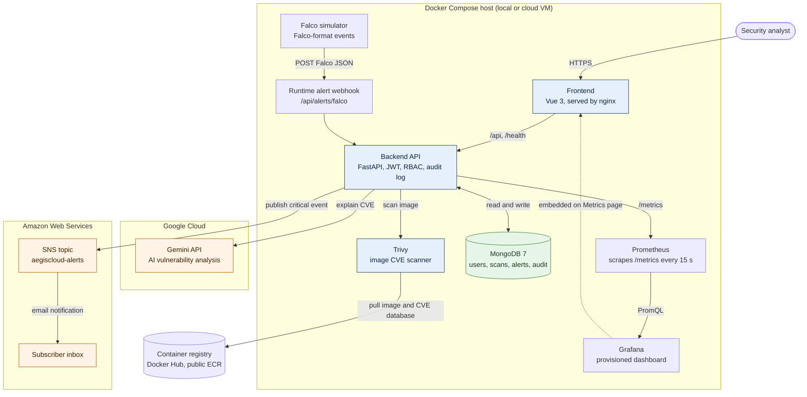

# AegisCloud

**Multi-cloud container security platform: vulnerability scanning, runtime alerting, AI-assisted remediation and cloud-native notifications.**

[](https://python.org)
[](https://fastapi.tiangolo.com)
[](https://vuejs.org)
[](https://mongodb.com)
[](https://docker.com)
[](https://aws.amazon.com)
[](https://cloud.google.com)
[](LICENSE)

---

## Overview

Container images ship with known vulnerabilities, and most teams learn about them only after deployment. AegisCloud addresses this with a platform that:

- scans Docker images for CVEs and stores every finding,
- receives runtime security alerts and tracks them to resolution,
- explains each CVE in plain language using a cloud AI service,
- notifies responders through a managed cloud messaging service, and
- presents posture on a live dashboard with Prometheus and Grafana metrics.

The system is designed around **two public clouds**, each used for the service it is best suited to, while the core platform runs in portable containers.

---

## Multi-cloud architecture

AegisCloud uses two cloud providers. Each one owns a distinct responsibility, and the application connects to both over HTTPS using its own credentials.

| Cloud provider | Service | Responsibility in AegisCloud |
|---|---|---|
| **Amazon Web Services (AWS)** | Simple Notification Service (SNS) | Publishes email notifications to subscribers when a critical scan or runtime alert is recorded |
| **Google Cloud** | Gemini API (Generative Language API) | Produces the three-part AI explanation of a vulnerability: what it is, the attack scenario, and remediation steps |

### Planned cloud components

The following components are part of the target architecture and are documented for future deployment. They are not implemented in the current release.

| Cloud provider | Service | Planned role |
|---|---|---|
| AWS | EC2 | Hosts the Docker Compose stack on a Linux virtual machine |
| AWS | CloudWatch | Centralises application and infrastructure logs |
| AWS | IAM | Least-privilege access for the application's SNS publishing role |

### Locally hosted components

Trivy, Falco (simulated), MongoDB, Prometheus, Grafana, the FastAPI backend and the Vue frontend run as Docker containers. They can be moved to any cloud without code changes.

---

## Architecture



---

## Request flow

1. **Scan.** The analyst submits an image. The API runs Trivy, stores the result, and returns severity counts. A critical result queues an SNS notification.
2. **Alert.** A Falco-format event is posted to the webhook. The API maps its priority, stores it, and queues an SNS notification for critical events.
3. **Explain.** The analyst requests an explanation. The API sends the CVE to Gemini and returns the structured answer.
4. **Monitor.** Prometheus scrapes request, scan and alert counters from `/metrics`. Grafana reads them through its Prometheus datasource and displays them on the Metrics page.

---

## Features

| Feature | Description |
|---|---|
| Image scanning | Trivy scans any Docker image; findings are stored and grouped by severity |
| Runtime alerts | Webhook accepts Falco-format detections, with priority mapping and acknowledgement |
| AI analysis | Gemini explains each CVE, with an attack scenario and remediation steps |
| Email notifications | SNS publishes critical scan and alert events to subscribed addresses |
| Live dashboard | Risk score, severity breakdown, recent scans, open alerts and activity |
| Monitoring | Prometheus metrics and a provisioned Grafana dashboard |
| Access control | JWT authentication, admin, analyst and viewer roles, audit log |
| Reports | Downloadable CSV and PDF scan reports |

---

## Technology stack

| Layer | Technology |
|---|---|
| Frontend | Vue 3, Pinia, Vue Router, Vite; served by nginx 1.27 |
| Backend | FastAPI, Motor, Pydantic v2 (Python 3.12) |
| Database | MongoDB 7 |
| Scanner | Trivy |
| AI | Google Gemini API |
| Notifications | AWS SNS, boto3 |
| Monitoring | Prometheus 2.55, Grafana 11.3 |
| Packaging | Docker Compose |

---

## Quick start

### Prerequisites

- Docker Desktop (Windows, macOS or Linux)
- A Gemini API key from Google AI Studio (optional, enables AI analysis)
- An AWS SNS topic and IAM credentials (optional, enables email notifications)

### 1. Clone and configure

```bash
git clone https://github.com/YOUR-USERNAME/AegisCloud.git
cd AegisCloud
```

Create the settings file from the template:

```bash
# macOS / Linux
cp backend/.env.example backend/.env

# Windows PowerShell
copy backend\.env.example backend\.env
```

Edit `backend/.env` and set at least `JWT_SECRET`, `DEMO_EMAIL` and `DEMO_PASSWORD`.

### 2. Start the stack

```bash
docker compose up -d --build
docker compose ps
```

Wait until `aegis-backend` and `aegis-mongo` report `healthy`.

### 3. Access the services

| Service | URL | Notes |
|---|---|---|
| Application | http://localhost:5173 | Sign in with `DEMO_EMAIL` and `DEMO_PASSWORD` |
| API documentation | http://localhost:8000/docs | OpenAPI (Swagger) interface |
| Prometheus | http://localhost:9090 | `aegiscloud-backend` should show as UP |
| Grafana | http://localhost:3000 | Login `admin` with `GF_SECURITY_ADMIN_PASSWORD` |

### 4. Generate demo data

```bash
cd backend
python scripts/simulate_falco_attack.py
```

Then scan an image such as `alpine:3.18` on the Image scans page.

### 5. Stop

```bash
docker compose down        # keeps stored data
docker compose down -v     # also deletes all stored data
```

---

## Configuration

Settings are read from `backend/.env`. The full list is in `backend/.env.example`.

| Variable | Required | Purpose |
|---|:---:|---|
| `JWT_SECRET` | Yes | Signs login tokens; use a long random value |
| `DEMO_EMAIL`, `DEMO_PASSWORD` | Yes | The account allowed to sign in |
| `SINGLE_ACCOUNT_MODE` | No | `true` restricts login to `DEMO_EMAIL` and disables sign-up |
| `GEMINI_API_KEY`, `GEMINI_MODEL` | No | Enables AI analysis |
| `AWS_SNS_TOPIC_ARN` | No | SNS topic for notifications |
| `AWS_ACCESS_KEY_ID`, `AWS_SECRET_ACCESS_KEY` | No | Credentials used to publish to SNS |
| `AWS_REGION` | No | AWS region of the topic (for example `ap-south-1`) |
| `SNS_NOTIFY_PRIORITIES` | No | Priorities that trigger email (default `critical`) |
| `FALCO_WEBHOOK_SECRET` | No | Shared secret required on the alert webhook |

`backend/.env` contains credentials and must never be committed. It is listed in `.gitignore`.

---

## Testing

```bash
cd backend
python -m venv .venv
.venv\Scripts\activate          # Windows; on macOS/Linux use: source .venv/bin/activate
pip install -r requirements.txt
pytest -q
```

Expected result: **49 passed**. The tests run against an in-memory database and stub every external service, so they need no Docker, Trivy, AWS or Gemini access.

---

## Security

- Passwords are hashed with bcrypt, and sessions use signed JWT tokens with an expiry.
- Role-based access control restricts scanning, alert handling and AI analysis to authorised roles.
- Every privileged action is written to the audit log.
- Image names are validated before they reach Trivy, which prevents option injection.
- The alert webhook can require a shared secret.
- Credentials are loaded at runtime from environment variables and are never baked into container images.

---

## Limitations

| Area | Current status |
|---|---|
| Runtime detection | Falco is simulated. The simulator posts Falco-format events to the real webhook. Running real Falco requires a Linux host with kernel access. |
| Image scanning | Requires network access to the image registry and to Trivy's vulnerability database |
| AI analysis | Depends on Gemini availability and may return temporary errors under load. Output should be verified against the CVE advisory and the scanner's fix-version data. |
| Accounts | Single-account mode is the default for this release |
| Deployment | Runs locally with Docker Compose. Cloud deployment and CI/CD are planned. |

---

## Roadmap

- Deploy the Docker Compose stack to an AWS EC2 instance
- Run Falco on a Linux host and connect it to the webhook
- Add CloudWatch log shipping and IAM role-based access for SNS
- Add a CI/CD pipeline that tests and builds on every push
- Extend the platform to a third cloud provider

---

## Project structure

```
AegisCloud/
├── backend/
│   ├── app/
│   │   ├── routes/        auth, scan, alerts, ai, dashboard, reports
│   │   ├── services/      Trivy, Falco mapping, SNS, Gemini, demo account
│   │   ├── middleware/    JWT authentication and role checks
│   │   ├── models/        Pydantic schemas
│   │   └── utils/         helpers and Prometheus metrics
│   ├── scripts/           Falco simulator and SNS test utility
│   ├── tests/             pytest suite
│   ├── main.py
│   └── Dockerfile
├── frontend/
│   ├── src/               views, components, router, store, services
│   ├── nginx.conf
│   └── Dockerfile
├── monitoring/
│   ├── prometheus/        scrape configuration and alert rules
│   └── grafana/           datasource and dashboard provisioning
├── falco/                 Falco reference configuration
└── docker-compose.yml
```

---
